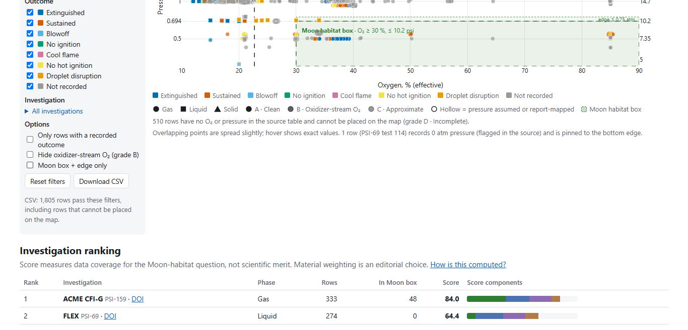

# Moon Fire Evidence Map

An evidence map of NASA's microgravity combustion experiments that ranks investigations by how much they tell us about fire in a Moon-habitat atmosphere, and shows exactly where the evidence stops.

**Live dashboard:** https://semanurcetinn.github.io/moon-fire-evidence-map/
**Demo slides:** DEMO_LINK

Space Chillers · NASA Space Apps Challenge 2026 · "Flame in Freefall"

## What it shows
- **Evidence Map** – every harmonized test row placed by oxygen and pressure, with the Moon habitat box (O₂ ≥ 30 %, ≤ 10.2 psi), the outcome of each test and how trustworthy each row is.
- **Investigation ranking** – the 12 harmonized investigations ranked by how much test-level evidence they give for a Moon-habitat atmosphere, with the score broken into its parts.
- **Where the evidence stops + insights** – the gaps in plain words, plain-language insight texts prepared with an SI assistant, machine-checked and approved by the team, an "Ask the evidence" box that counts matching tests live, and a CSV download of any filtered selection.

## Key findings
- **87** test rows fall inside the Moon habitat box: 20 clean (A), 46 oxidizer-stream (B), 21 approximate (C).
- The **20** clean rows are all gas flames: 13 extinguished, 4 sustained, 2 cool flames, 1 not recorded.
- **0** solid-fuel tests reach 30 % oxygen; the highest oxygen in any solid-fuel test is **22.7 %**.
- An outcome is recorded for only **668 of 1,805** rows.

## Data
- Source: NASA Physical Sciences Informatics (PSI). 25 investigations were reviewed; 12 are harmonized into one table of 1,805 test rows (`data/experiments.csv`, dashboard copy `data/experiments_dashboard.csv`); English column guide in `docs/COLUMNS.md`.
- The frozen package (v3.1) and its sha256 hashes are in `docs/FREEZE.md` and `MANIFEST.sha256`; the dashboard file `web/data/app_data.json` is built by `scripts/build_dashboard_data.py`.
- Citation: every investigation DOI is listed in `data/investigations.csv` and linked in the dashboard.

## Method
- No source value was corrected; suspect values are kept and flagged. Every row traces back to its NASA source file and row.
- Each row has an evidence grade: **A** clean test-level row · **B** oxygen is the burner oxidizer fraction · **C** approximate (summary row, assumed or report-mapped pressure, anomaly) · **D** oxygen or pressure missing.
- Ranking: `score = 35·moon + 25·quality + 20·outcome + 20·material`, explained in [`docs/METHOD_RANKING.md`](docs/METHOD_RANKING.md). It measures data coverage for the Moon-habitat question, not scientific merit.
- Checks: `scripts/verify_facts.py` recomputes the headline numbers independently; `scripts/check_numbers.py` checks every number in the public texts against the dataset.

## Limits
- Evidence in the Moon habitat box is gaseous-flame and liquid-droplet evidence; there is no solid-fuel test at ≥ 30 % O₂ in PSI.
- 1,137 of 1,805 rows record no outcome; "not recorded" is not "did not extinguish".
- Grade B oxygen values are burner oxidizer fractions, not cabin air.
- PSI-20 pressures are mapped from the final report, not measured per test.
- PSI has no partial-gravity combustion data yet; microgravity and normal-gravity results can only bound lunar conditions (as the challenge description notes; LUCI and FM2 are expected to add such data).

## License
- Code: MIT (`LICENSE`).
- Data: NASA PSI, CC0-1.0 for all investigations except PSI-10, whose license is not specified; cite PSI-10 by DOI 10.60555/w4zy-bt45.

## Team
Space Chillers, Muğla Sıtkı Koçman University: 

- Şehr-i Sena Demirbaş
- Sema Nur Çetin 
- Esra Ceren Saçmaz
- Müberra Çoban 
- Fatma Susam
- Mehmet Doğukan Özer

---
Not an official NASA product. Not a safety assessment.
